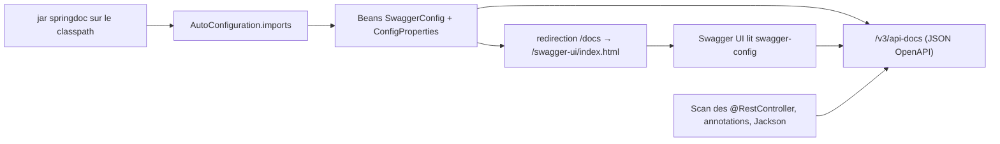
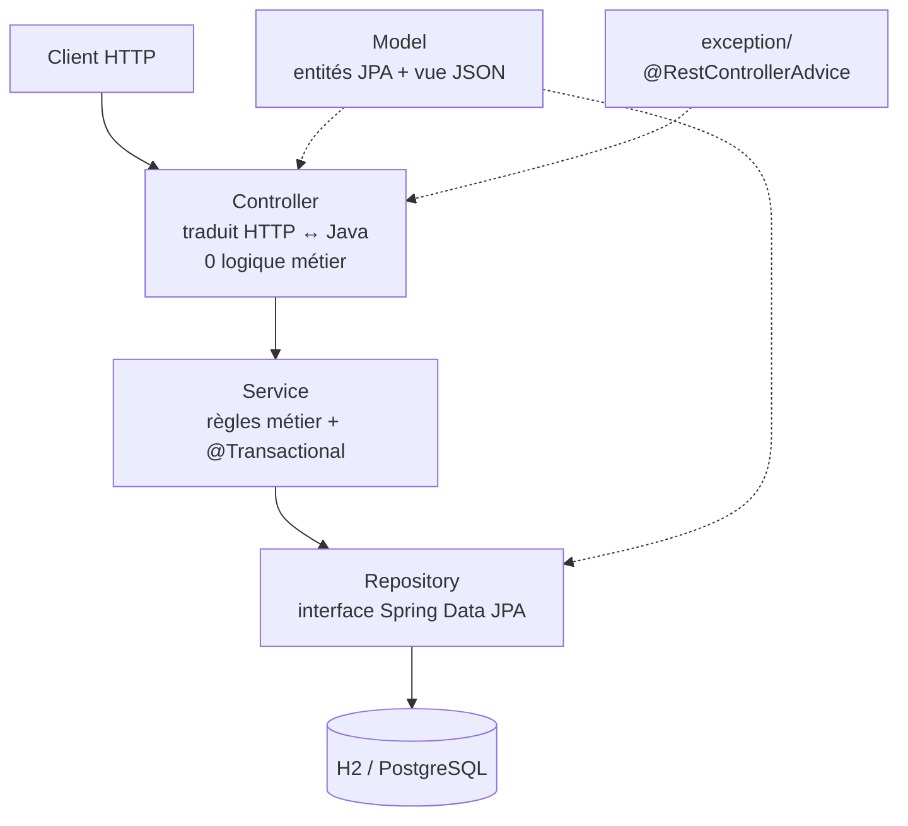

# 📘 Comprendre le projet Board — Swagger, OpenAPI et les ajouts

> **Objectif** : ne pas seulement *utiliser* l'API, mais comprendre **pourquoi** chaque
> ligne existe et **comment** Spring la transforme en comportement concret.
>
> Toutes les commandes ci-dessous partent de la racine du projet, avec l'application lancée
> (`./mvnw spring-boot:run`, port 8080). Pour les exemples `curl`, remplacez `8080` par votre port.
>
> Ce guide décrit **le code réel de ce dépôt** et les résultats **réellement observés**
> (Spring Boot 3.5.6, JDK 25, springdoc 2.8.13, Hibernate 6.6, H2 2.3).

---

## 0. Le vocabulaire (on confond souvent ces mots)

| Mot | Ce que c'est vraiment | Dans ce projet |
|-----|----------------------|----------------|
| **API REST** | Une convention : on utilise des URL + verbes HTTP pour manipuler des ressources | `/api/users`, `POST`, `GET`, `PUT`, `PATCH`, `DELETE` |
| **OpenAPI** | Une **spécification** : un format de fichier (JSON ou YAML) qui *décrit* une API (chemins, paramètres, schémas, réponses). Ce n'est pas du code. | Le JSON servi par `/v3/api-docs` (version **3.1.0**) |
| **Swagger UI** | Une **page web** qui lit un document OpenAPI et affiche une documentation interactive avec un bouton « Try it out » | `/docs` |
| **springdoc-openapi** | La bibliothèque qui **fabrique** le document OpenAPI en analysant votre code Spring | La dépendance du `pom.xml` |
| **springfox** | L'ancienne bibliothèque de l'époque Spring Boot 2 / `javax.*` | ❌ Incompatible avec Spring Boot 3 / `jakarta.*` |
| **JSON Schema** | Le sous-langage d'OpenAPI qui décrit la forme des objets | `components.schemas.Task` |
| **WebJar** | Un fichier `.jar` qui contient du HTML/JS/CSS au lieu de classes Java | `swagger-ui-5.28.1.jar` contient `index.html` |

**Analogie** : OpenAPI est le *plan* de la maison, Swagger UI est la *visite guidée*,
springdoc est l'*architecte* qui dessine le plan en regardant la maison (votre code).

---

# Partie A — Comment Swagger a été ajouté

## A.1 Une seule dépendance… et tout le reste vient avec

```xml
<!-- pom.xml -->
<dependency>
    <groupId>org.springdoc</groupId>
    <artifactId>springdoc-openapi-starter-webmvc-ui</artifactId>
    <version>2.8.13</version>
</dependency>
```

Décomposons le nom :

- `webmvc` → version pour **Spring MVC + Tomcat** (il existe une variante `webflux`).
- `ui` → embarque Swagger UI **en plus** de la génération du JSON.
- `starter` → ce n'est qu'un POM qui tire d'autres dépendances.
- **Version explicite** : springdoc ne fait pas partie du *BOM* Spring Boot
  (contrairement à `spring-boot-starter-web` dont la version est gérée par le parent).
  C'est pour ça qu'on écrit `<version>2.8.13</version>`.

Arbre réel des dépendances (observé dans les POM des jars) :

```
springdoc-openapi-starter-webmvc-ui 2.8.13
├── springdoc-openapi-starter-webmvc-api 2.8.13
│   └── springdoc-openapi-starter-common 2.8.13
│       ├── swagger-core-jakarta / swagger-models-jakarta / swagger-annotations-jakarta 2.2.36
│       ├── jackson-dataformat-yaml 2.19.2
│       └── commons-lang3
├── org.webjars:swagger-ui 5.28.1          ← le HTML/JS de l'interface
├── org.webjars:webjars-locator-lite 1.1.0 ← retrouve la version du WebJar
└── jakarta.servlet-api (scope provided)   ← fourni par Tomcat, pas empaqueté
```

👉 Chez vous, **Maven fait tout ça automatiquement** : `mvn dependency:tree` l'affiche.

### Anecdote instructive : le classpath, ça ne s'improvise pas

Dans le sandbox d'Arena il n'y a ni JDK ni Maven. J'ai donc reconstruit un classpath à la main
pour vérifier le projet. L'application a alors refusé de démarrer deux fois :

```
Caused by: java.lang.NoClassDefFoundError: org/apache/commons/lang3/StringUtils
... puis ...
Caused by: java.lang.NoClassDefFoundError: org/webjars/WebJarVersionLocator
```

Ce sont deux dépendances **transitives** de springdoc. La leçon : un « starter » cache un
graphe entier ; une classe manquante suffit à empêcher le contexte Spring de démarrer, et
l'erreur ne mentionne pas la dépendance à ajouter mais la **classe** manquante.

## A.2 L'auto-configuration : pourquoi aucune classe de config n'est nécessaire

Spring Boot 3 lit, dans chaque jar, le fichier :

```
META-INF/spring/org.springframework.boot.autoconfigure.AutoConfiguration.imports
```

Contenu exact de `springdoc-openapi-starter-webmvc-ui-2.8.13.jar` :

```
org.springdoc.webmvc.ui.SwaggerConfig
org.springdoc.core.properties.SwaggerUiConfigProperties
org.springdoc.core.properties.SwaggerUiOAuthProperties
```

Spring instancie donc ces classes tout seul. Elles enregistrent notamment :

| Bean / classe | Rôle |
|---------------|------|
| `OpenApiResource` | Sert le JSON sur `/v3/api-docs` |
| `SwaggerConfigResource` | Sert `/v3/api-docs/swagger-config` |
| `SwaggerWebMvcConfigurer` | `addViewControllers()` (la redirection) + `addResourceHandlers()` (sert `/swagger-ui/**` depuis le WebJar) |
| `SwaggerWelcomeWebMvc` / `SwaggerIndexTransformer` | Injecte `configUrl` dans le `index.html` |
| `SwaggerResourceResolver` + `WebJarVersionLocator` | Trouve la bonne version du WebJar |
| `SwaggerUiConfigProperties` | Lit `springdoc.swagger-ui.*` depuis `application.properties` |



**Aucun `@EnableSwagger2`, aucune classe Java dans notre code** : c'est la magie (documentée)
des starters Spring Boot.

## A.3 Les URLs réellement exposées

| URL | Résultat observé |
|-----|------------------|
| `/v3/api-docs` | JSON OpenAPI **3.1.0**, `info.title = "OpenAPI definition"`, **7 chemins** |
| `/v3/api-docs/swagger-config` | `{"configUrl":"/v3/api-docs/swagger-config","url":"/v3/api-docs","oauth2RedirectUrl":"...","validatorUrl":""}` |
| `/swagger-ui.html` | Point d'entrée **par défaut** de springdoc… mais **404 ici** : dès qu'on personnalise `springdoc.swagger-ui.path`, la redirection n'est enregistrée que sur le nouveau chemin |
| `/swagger-ui/index.html` | **200** : la vraie page HTML (issue du WebJar), cible de la redirection |
| `/docs` | **302** avec `Location: /swagger-ui/index.html` (notre configuration) |

```bash
curl -i http://localhost:8080/docs
# HTTP/1.1 302
# Location: /swagger-ui/index.html

curl -s http://localhost:8080/v3/api-docs | python -m json.tool | head -20
```

Le navigateur suit la redirection, charge le `index.html` du WebJar, puis ce `index.html`
appelle `swagger-config`, qui lui dit « le document à afficher est `/v3/api-docs` ».
**Trois requêtes, trois rôles différents** : c'est important à comprendre.

## A.4 Pourquoi `/docs` renvoyait 500 au début — deux bugs distincts

1. **springdoc n'écoutait pas `/docs`.** Par défaut `springdoc.swagger-ui.path` vaut
   `/swagger-ui.html`. Une requête sur `/docs` ne trouvait donc aucun handler et Spring
   levait `NoResourceFoundException` (qui **porte déjà le statut 404**).
2. **Notre `@ExceptionHandler(Exception.class)` « fourre-tout » attrapait cette exception
   et forçait un 500.** C'est le bug que vous avez signalé.

Les deux corrections :

```properties
# application.properties
springdoc.swagger-ui.path=/docs
```

```java
// GlobalExceptionHandler : on respecte le statut porte par Spring, on ne l'ecrase plus
if (ex instanceof ErrorResponse errorResponse) {
    HttpStatus status = HttpStatus.resolve(errorResponse.getStatusCode().value());
    if (status != null) {
        return build(status, springMessage(errorResponse, status), request, null);
    }
}
log.error("Erreur inattendue ...", ex);           // seulement pour les vraies erreurs
return build(HttpStatus.INTERNAL_SERVER_ERROR, ...);
```

`springdoc.swagger-ui.path` est lu par `SwaggerUiConfigProperties`
(`@ConfigurationProperties(prefix = "springdoc.swagger-ui")`), puis
`SwaggerWebMvcConfigurer` fait approximativement :

```java
registry.addRedirectViewController("/docs", "/swagger-ui/index.html");
```

⚠️ C'est une **redirection**, pas une copie : le HTML vient toujours du WebJar.

## A.5 Comment le document OpenAPI est fabriqué (le cœur du sujet)

springdoc **ne lit ni vos commentaires ni un fichier YAML** : il introspecte le
`RequestMappingHandlerMapping` de Spring (la table des routes) puis interroge Jackson et
Bean Validation pour décrire les types.

Exemple réel, extrait de `POST /api/boards/{boardId}/tasks` dans `/v3/api-docs` :

```json
{
  "tags": ["task-controller"],
  "operationId": "createTask",
  "parameters": [
    { "name": "boardId", "in": "path", "required": true,
      "schema": { "type": "integer", "format": "int64" } }
  ],
  "requestBody": {
    "content": { "application/json": {
      "schema": { "$ref": "#/components/schemas/Task" } } },
    "required": true
  },
  "responses": { "201": { "description": "Created", "content": { "...": {} } } }
}
```

| Morceau du JSON | D'où ça vient dans le code |
|-----------------|----------------------------|
| `tags: ["task-controller"]` | Nom de la classe `TaskController` (springdoc le « dé-camelise ») |
| `operationId: "createTask"` | Nom de la méthode Java |
| `parameters[0].name = boardId` | `@PathVariable("boardId")` |
| `requestBody.required = true` | `@RequestBody Task` |
| `$ref: .../Task` | Le type du paramètre, résolu en schéma |
| `responses: {"201": ...}` | `@ResponseStatus(HttpStatus.CREATED)` (voir A.6) |

### Le schéma `Task` réellement généré

```json
{
  "type": "object",
  "properties": {
    "id":          { "type": "integer", "format": "int64" },
    "title":       { "type": "string", "minLength": 1 },
    "description": { "type": "string", "maxLength": 1000, "minLength": 0 },
    "status":      { "type": "string", "enum": ["A_FAIRE", "EN_COURS", "TERMINE"] },
    "boardId":     { "type": "integer", "format": "int64", "readOnly": true }
  },
  "required": ["title"]
}
```

**Tableau à retenir — annotation Java → conséquence dans Swagger :**

| Annotation (sur `Task`) | Effet dans le schéma OpenAPI |
|-------------------------|------------------------------|
| `@NotBlank private String title` | `required: ["title"]` + `minLength: 1` |
| `@Size(max = 1000) private String description` | `maxLength: 1000` |
| `private TaskStatus status` (enum) | `enum: ["A_FAIRE","EN_COURS","TERMINE"]` |
| `@Email private String email` (sur `User`) | `format: "email"` |
| `@NotNull` sur `StatusUpdateRequest.status` | `required: ["status"]` |
| `@JsonIgnore` sur `board`, `tasks`, `owner`, `boards` | Ces propriétés **n'apparaissent pas** |
| `@JsonProperty(access = READ_ONLY)` | `readOnly: true` |
| `LocalDateTime createdAt` | `{"type":"string","format":"date-time"}` |
| `@Column`, `@Entity`, `@JoinColumn` (JPA) | **Aucun effet** sur OpenAPI |

👉 Deux mondes bien séparés : **JPA** décrit la base, **Jackson + Bean Validation**
décrivent le JSON. Swagger se construit sur le second.

Deux détails observés :

- `TaskStatus` n'apparaît **pas** comme schéma nommé : springdoc « inline » les enums
  par défaut (on peut le changer avec `@Schema`).
- `User` génère `required: ["email","firstName","lastName"]` uniquement grâce aux
  `@NotBlank` — la validation et la documentation sont **la même information**, pas deux
  choses à maintenir.

## A.6 Le piège du `201` documenté comme `200` (et sa correction)

Nos contrôleurs écrivent :

```java
return ResponseEntity.status(HttpStatus.CREATED).body(created);
```

C'est du **code exécuté à l'exécution**. springdoc, lui, fait une analyse **statique** des
annotations : il ne peut pas deviner ce que `ResponseEntity.status(...)` va retourner.
Avant correction, `/v3/api-docs` annonçait donc `post: {responses: {"200": ...}}` alors que
l'API répondait bien `201`.

Correctif appliqué sur les trois POST :

```java
@PostMapping
@ResponseStatus(HttpStatus.CREATED)     // métadonnée visible par springdoc
public ResponseEntity<Task> createTask(...) {
    return ResponseEntity.status(HttpStatus.CREATED).body(created);
}
```

Résultat vérifié :

```bash
curl -s -o /dev/null -w '%{http_code}\n' -X POST .../api/users -H 'Content-Type: application/json' -d '...'
# 201                          ← comportement réel (ResponseEntity gagne)

curl -s .../v3/api-docs | python -c "import json,sys; d=json.load(sys.stdin); print(d['paths']['/api/users']['post']['responses'].keys())"
# dict_keys(['201'])           ← documentation exacte (@ResponseStatus)
```

**Leçon** : pour qu'une information apparaisse dans Swagger, il faut qu'elle soit une
*annotation* (métadonnée), pas seulement une instruction dans le corps de la méthode.

## A.7 Personnaliser la documentation (à essayer)

```java
// 1) Titre, version, description globales — nouvelle classe
@OpenAPIDefinition(info = @Info(title = "Board API", version = "1.0",
                               description = "Gestion de tableaux et de tâches"))
@Configuration
public class OpenApiConfig { }
```

```java
// 2) Sur un contrôleur / une méthode
@Tag(name = "Tâches", description = "Cycle de vie des tâches d'un tableau")
@RestController
public class TaskController {

    @Operation(summary = "Créer une tâche",
               description = "Le statut est forcé à A_FAIRE, quelle que soit la valeur envoyée.")
    @ApiResponses({
        @ApiResponse(responseCode = "201", description = "Tâche créée"),
        @ApiResponse(responseCode = "404", description = "Tableau introuvable"),
        @ApiResponse(responseCode = "400", description = "Titre manquant")
    })
    @PostMapping
    public ResponseEntity<Task> createTask(
            @Parameter(description = "Identifiant du tableau") @PathVariable("boardId") Long boardId,
            @Valid @RequestBody Task task) { ... }
}
```

```java
// 3) Sur un champ d'entité / de DTO
@Schema(description = "Statut courant", example = "EN_COURS")
private TaskStatus status;
```

```properties
# 4) Groupes (plusieurs documents), désactivation en production
springdoc.group-configs[0].group=public
springdoc.group-configs[0].paths-to-match=/api/**
springdoc.api-docs.enabled=false
springdoc.swagger-ui.enabled=false
```

## A.8 Pièges classiques

| Piège | Symptôme / remède |
|-------|-------------------|
| Utiliser `springfox` (Boot 2 / `javax`) | Ne fonctionne pas avec Spring Boot 3 → utiliser `springdoc` |
| Version springdoc inadaptée | `NoSuchMethodError` au démarrage → aligner springdoc et Spring Boot (ici 2.8.13 / 3.5.6) |
| Exposer directement les entités JPA | La doc montre le modèle de persistance ; préférer des **DTO** pour une API publique |
| `@JsonIgnore` | Retire aussi le champ de la doc (voulu ici pour `owner`, `board`, `tasks`) |
| `ResponseEntity.status(...)` | Invisible pour springdoc → ajouter `@ResponseStatus` ou `@ApiResponse` |
| Personnaliser `springdoc.swagger-ui.path` | L'ancien `/swagger-ui.html` ne répond plus (404) ; seule la nouvelle URL redirige. `/swagger-ui/index.html` reste accessible |
| Reverse proxy / contexte | Les URL dans `swagger-config` doivent rester valides derrière le proxy (`server.forward-headers-strategy=framework`) |
| Oublier les dépendances transitives | `NoClassDefFoundError` (voir A.1) |

---

# Partie B — Comment les ajouts ont été faits

## B.1 L'architecture et pourquoi elle existe



Une seule responsabilité par couche. Conséquence concrète : `TaskController` ne contient
**aucun** `if` métier ; il délègue tout à `TaskService`. C'est ce qui permet de tester les
règles (Mockito) sans démarrer de serveur.

## B.2 La démarche suivie (transposable à vos projets)

1. **Lire tous les fichiers** et lister les erreurs de compilation *avant* de toucher au code.
2. **Corriger la compilation** (packages, imports, enum) — rien ne sert de raisonner sur le
   comportement si le projet ne compile pas.
3. **Corriger la configuration** (`pom.xml`, `application.properties`).
4. **Corriger le comportement à l'exécution** — avec des tests réels, pas seulement un `javac`.
5. **Compléter les méthodes manquantes** (CRUD, erreurs, validation, docs).
6. **Verrouiller avec des tests** pour ne pas régresser.

## B.3 Les leçons, thème par thème

### 1) Résolution des symboles en Java

`UserService` n'avait **pas de `package`** → il était dans le *package par défaut*, donc
`import com.example.Board.service.UserService` ne pouvait pas le trouver. Il importait aussi
`com.example.Board.service` (un package, pas une classe), `com.example.Board.userRepository`
(inexistant) et `org.hibernate.annotations.GenericGenerators` (supprimé en Hibernate 6).
`TaskService` avait un **second bloc `package`/`import` après l'accolade fermante** et
n'importait pas `TaskRepository`. Enfin `TaskStatus` déclarait `TODO/IN_PROGRESS/DONE`
alors que le code utilisait `A_FAIRE/EN_COURS/TERMINE` → `cannot find symbol`.

> 📌 Le `package` est **l'adresse logique** d'une classe ; le dossier est son adresse physique.
> Une constante d'enum est un symbole vérifié à la compilation, pas une chaîne.

Les dossiers `Controller/`, `Model/`, `Repository/`, `Service/` ont été renommés en minuscules
pour correspondre aux packages déclarés (sur Linux, la casse compte).

### 2) Lombok et le JDK 23+ (erreur de build très fréquente)

Lombok n'est pas « magique » : c'est un **annotation processor**, un plugin de `javac` qui
génère getters/setters/constructeurs pendant la compilation. Depuis le **JDK 23**, `javac`
ne découvre plus implicitement les processors présents sur le classpath. Il faut les déclarer :

```xml
<plugin>
    <artifactId>maven-compiler-plugin</artifactId>
    <configuration>
        <release>${java.version}</release>
        <parameters>true</parameters>          <!-- noms de paramètres pour Spring MVC -->
        <annotationProcessorPaths>
            <path>
                <groupId>org.projectlombok</groupId>
                <artifactId>lombok</artifactId>
                <version>${lombok.version}</version>
            </path>
        </annotationProcessorPaths>
    </configuration>
</plugin>
```

Sans `<parameters>true</parameters>`, Spring ne peut pas retrouver le nom d'un
`@RequestParam Long ownerId` par réflexion :

```
Name for argument of type [java.lang.Long] not specified, and parameter name
information not available via reflection. Ensure that the compiler uses '-parameters'.
```

On a aussi écrit les noms explicitement — `@RequestParam("ownerId")`,
`@PathVariable("boardId")` — pour ne plus dépendre du tout de ce flag.

### 3) Spring Data JPA : les requêtes dérivées… et leur limite

Normalement `findByOwnerId(Long)` est traduit par Spring Data en
`SELECT b FROM Board b WHERE b.owner.id = ?` : il découpe le nom en mots (`Owner`, `Id`)
et descend dans la relation `owner`.

Mais au démarrage, erreur réelle :

```
Could not create query for method ... findByOwnerId(java.lang.Long);
Could not resolve attribute 'ownerId' of 'com.example.Board.model.Board'
```

**Pourquoi ?** Nous avions ajouté un getter **calculé** pour l'API JSON :

```java
@JsonProperty(value = "ownerId", access = READ_ONLY)
public Long getOwnerId() { return owner == null ? null : owner.getId(); }
```

L'introspecteur JavaBeans voit donc une **propriété `ownerId`**. Spring Data essaie d'abord
le nom entier, le prend pour un attribut JPA… qui n'existe pas (JPA utilise ici l'accès par
champ, et il n'y a pas de champ `ownerId`).

Deux solutions :

```java
// ✅ retenue : explicite, aucun risque d'ambiguïté
@Query("select b from Board b where b.owner.id = :ownerId")
List<Board> findByOwnerId(@Param("ownerId") Long ownerId);

// ✅ alternative : le « _ » force la traversée de la relation
List<Board> findByOwner_Id(Long ownerId);
```

> 📌 Leçon : **un simple getter peut changer le comportement d'un framework** qui fait de
> l'introspection. Ce n'était pas détectable à la compilation : seul le démarrage du contexte
> Spring l'a révélé. D'où l'intérêt du test `@SpringBootTest`.

### 4) JPA / Hibernate

- `@ManyToOne(fetch = LAZY)` + `@JoinColumn` : `Task` porte la colonne `board_id`.
- `mappedBy` : côté inverse d'une relation ; il ne crée **pas** de colonne.
- `cascade = ALL, orphanRemoval = true` : supprimer un `Board` supprime ses `Task`
  (et supprimer un `User` supprime ses `Board`, donc leurs `Task`).
- `@PrePersist` : filet de sécurité pour `createdAt` et pour le statut initial `A_FAIRE`.
- `@Enumerated(EnumType.STRING)` : on stocke le **nom**, pas l'index. Le DDL H2 réel :

```sql
create table tasks (
    id bigint generated by default as identity,
    description varchar(1000),
    status enum ('A_FAIRE','EN_COURS','TERMINE') not null,
    title varchar(255) not null,
    board_id bigint not null,
    primary key (id)
)
```

Si on avait utilisé `ORDINAL`, insérer `EN_COURS` entre deux valeurs aurait *changé le sens*
de toutes les lignes déjà enregistrées.

### 5) Jackson et les proxies Hibernate

Une association `LAZY` n'est pas un objet ordinary : c'est un **proxy** (ByteBuddy). Si
Jackson le sérialise, il tente d'écrire `hibernateLazyInitializer` → erreur, ou il force un
chargement après la fermeture de la transaction → `LazyInitializationException`.

Solutions retenues :

```java
@JsonIgnore                                       // pas d'entité imbriquée
@ManyToOne(fetch = LAZY) private User owner;

@JsonProperty(value = "ownerId", access = READ_ONLY)  // seulement l'identifiant
public Long getOwnerId() { ... }
```

plus `spring.jpa.open-in-view=false` (on ne garde **pas** une session ouverte pendant la
sérialisation) et `@JsonIgnoreProperties({"hibernateLazyInitializer","handler"})` sur les entités.

👉 Ces mêmes annotations produisent `readOnly: true` et l'absence de champs dans Swagger
(voir A.5) : **un seul endroit, deux effets cohérents**.

### 6) Validation

`@Valid` sur les `@RequestBody` de création déclenche Bean Validation
(`@NotBlank`, `@Email`, `@Size`, `@NotNull`). En cas d'échec, Spring lève
`MethodArgumentNotValidException`, que notre `GlobalExceptionHandler` transforme en 400
avec les détails par champ :

```json
{"status":400,"error":"Bad Request","message":"Validation de la requete echouee",
 "fieldErrors":{"firstName":"ne doit pas être vide","email":"..."},"path":"/api/users"}
```

Les `PUT` sont des **mises à jour partielles** : ils ne portent pas `@Valid` (sinon un corps
`{"status":"EN_COURS"}` serait refusé parce que `title` est absent). Le service n'applique
que les champs non nuls — `null` signifie « ne pas modifier ».

### 7) Transactions

```java
@Service
@Transactional(readOnly = true)      // défaut pour les lectures
public class TaskService {
    @Transactional                    // écriture : commit / rollback
    public Task createTask(...) { ... }
}
```

Sans transaction, une entité lue puis modifiée est *détachée* : le *dirty checking*
d'Hibernate ne s'applique plus. Les `save()` explicites restent dans le code pour être
lisibles, même si Hibernate persisterait les changements tout seul à la fin de la transaction.

### 8) Gestion des erreurs et le bug du « fourre-tout »

`@RestControllerAdvice` = un intercepteur global qui transforme les exceptions en réponses
HTTP. Nos exceptions métier (`ResourceNotFoundException` → 404,
`DuplicateResourceException` → 409) donnent un corps homogène `ApiError`.

Le piège, rencontré en vrai :

```java
@ExceptionHandler(Exception.class)   // ❌ attrape AUSSI les exceptions de Spring MVC
public ResponseEntity<ApiError> handleUnexpected(Exception ex, ...) {
    return build(HttpStatus.INTERNAL_SERVER_ERROR, ...);   // un 404 devient 500
}
```

Les exceptions de la couche web implémentent `org.springframework.web.ErrorResponse`
et **portent déjà leur statut** : `NoResourceFoundException` → 404,
`HttpRequestMethodNotSupportedException` → 405, `ServletRequestBindingException` → 400…
La correction consiste à lire `errorResponse.getStatusCode()` et à ne journaliser en 500
que les erreurs vraiment inattendues (avec la stack trace, désormais visible dans les logs).

Vérifié en direct :

```bash
curl -s http://localhost:8080/inconnu
# {"status":404,"message":"No static resource inconnu.","path":"/inconnu", ...}

curl -s http://localhost:8080/api/users/abc
# {"status":400,"message":"Requete invalide : ... Failed to convert value ... \"abc\"", ...}
```

### 9) Cohérence et sécurité de l'API

| Avant | Après | Pourquoi |
|-------|-------|----------|
| `TaskController` ignorait `boardId` | Toutes les opérations passent par `findByIdAndBoardId` | On ne doit pas lire une tâche depuis l'URL d'un autre tableau |
| `updateTask` écrasait `status` par `null` | Mise à jour partielle | Évite une violation de contrainte en base |
| Le client pouvait envoyer `id`, `createdAt`, `owner`, `board` | Ces champs sont imposés par le serveur | Un client ne doit pas pouvoir écraser une entité existante |
| `GET /api/boards/{id}/tasks` → `200 []` si le tableau n'existe pas | `404` | Une collection vide et une ressource absente sont deux choses différentes |
| `RuntimeException` → 500 partout | 400 / 404 / 405 / 409 / 500 | Un code HTTP est une information pour le client |

### 10) Tests : deux niveaux complémentaires

| Test | Outil | Ce qu'il prouve |
|------|-------|-----------------|
| `UserServiceTest`, `BoardServiceTest`, `TaskServiceTest` | JUnit 5 + Mockito (`@Mock`, `@InjectMocks`) | Les **règles métier** : email unique, statut forcé `A_FAIRE`, mise à jour partielle, rattachement au tableau |
| `BoardApiIntegrationTest` | `@SpringBootTest(RANDOM_PORT)` + `TestRestTemplate` | Le **système entier** : Tomcat, H2, JSON, codes HTTP, `/docs`, `/v3/api-docs`, cascades de suppression |
| `BoardApplicationTests` | `@SpringBootTest` | Le contexte Spring démarre (détecte les erreurs de requêtes dérivées !) |

```bash
./mvnw clean verify     # 16 tests, tous verts
```

Les deux classes `@SpringBootTest` imposent H2 via `TestEnvironment` : voir
**B.6** pour l'incident PostgreSQL et l'ordre de priorité des propriétés.

## B.4 Tableau récapitulatif : erreur → cause → leçon

| Symptôme | Cause profonde | Leçon |
|----------|----------------|-------|
| `cannot find symbol` sur `A_FAIRE` | Enum et code désaccordés | Un enum est un contrat, y compris pour le JSON |
| Classe de service introuvable | `package` absent / imports invalides | Package = adresse logique |
| Erreur de syntaxe en fin de `TaskService` | Bloc `package` dupliqué | Toujours lire le fichier jusqu'à la dernière ligne |
| `cannot find symbol getTitle()` | Lombok non exécuté (JDK 23+) | Déclarer l'annotation processor |
| 400 « parameter name not available » | Compilation sans `-parameters` | Nommer explicitement les paramètres |
| `Could not resolve attribute 'ownerId'` | Getter calculé vu comme propriété JPA | L'introspection a des effets de bord |
| 500 sur une URL inconnue | `@ExceptionHandler(Exception.class)` | Respecter `ErrorResponse` |
| `LazyInitializationException` / proxy dans le JSON | Association `LAZY` sérialisée | Ignorer l'association, exposer l'id |
| 200 dans Swagger pour un POST 201 | `ResponseEntity` invisible à l'analyse statique | Documenter avec des annotations |
| Tâche accessible depuis un autre `boardId` | `boardId` ignoré par le contrôleur | Valider la portée de chaque ressource |

## B.5 Comment tout cela a été vérifié (transparence)

Le sandbox qui héberge ce travail n'a **ni JDK, ni Maven**, et n'accède pas à Maven Central.
Pour ne pas livrer du code « qui a l'air juste », j'ai reconstruit en temporaire (hors dépôt) :

1. un **compilateur Java** (ECJ) et un JRE 25 ;
2. un classpath complet Spring Boot 3.5.6 / Hibernate / Jackson / JUnit / Mockito / springdoc ;
3. une simulation de la génération Lombok pour la compilation ;
4. un lanceur JUnit + l'application démarrée sur un vrai port pour les appels `curl`.

Résultats : **0 erreur de compilation** sur 24 fichiers, **16/16 tests verts**,
`POST` → 201, `/docs` → 302, `/v3/api-docs` → 200 (OpenAPI 3.1.0), URL inconnue → 404,
mauvais id → 400. Chez vous, `./mvnw clean verify` rejoue tout ça nativement.

## B.6 Incident « PostgreSQL au lieu de H2 » : qui décide de la config ?

C'est un incident très formateur, arrivé sur **votre** machine après le premier
`git pull`. Le code n'avait pas changé, mais les tests, si.

### 1) Lire un rapport d'échec comme une enquête

```text
Tests run: 16, Failures: 0, Errors: 2
  UserServiceTest          5/5  ✓
  BoardServiceTest         4/4  ✓
  TaskServiceTest          5/5  ✓
  BoardApplicationTests::contextLoads                          ✗ ERREUR
  BoardApiIntegrationTest::parcoursCompletEtGestionDesErreurs  ✗ ERREUR
```

**Indice n°1 : quels tests échouent ?** Exactement les deux annotés
`@SpringBootTest`. Les 14 autres sont des tests Mockito : ils instancient un
service à la main, sans contexte Spring, donc **sans `DataSource`**. Le dénominateur
commun des deux erreurs est donc « démarrage du contexte » → base de données.

**Indice n°2 : la chaîne de causes**, à lire de bas en haut (le dernier
`Caused by` est la cause réelle) :

```text
BeanCreationException: entityManagerFactory
  → PersistenceException: Unable to build Hibernate SessionFactory
    → GenericJDBCException: Unable to open JDBC Connection for DDL execution
      → PSQLException: FATAL: password authentication failed for user "postgres"
```

`entityManagerFactory` a besoin d'une connexion **au démarrage** parce que
`spring.jpa.hibernate.ddl-auto=update` lui demande de créer/mettre à jour les
tables. `ddl-auto` n'est pas la cause : c'est le déclencheur de la connexion.

Les noms `HikariCP-6.3.3.jar` et `postgresql-42.7.7.jar` dans la trace ne sont
pas des coupables non plus : le pool et le driver **obéissent** à l'URL et aux
identifiants qu'on leur a donnés.

### 2) Le très long `ConditionEvaluationReport` est du bruit

Quand un contexte échoue, Spring Boot imprime son *Condition Evaluation Report* :
des centaines de lignes « Positive matches / Negative matches / Unconditional
classes ». C'est un **inventaire de ce qui a été essayé**, pas une liste d'erreurs.
Les auto-configurations sont annotées `@ConditionalOnClass`,
`@ConditionalOnMissingBean`, `@ConditionalOnProperty`… et **il est normal que la
majorité ne s'appliquent pas**.

Trois exemples pris dans votre log :

| Ligne du rapport | Traduction |
|------------------|------------|
| `SwaggerConfig#springWebProvider` … *did not match* | `@ConditionalOnMissingBean` : le bean existait déjà. **Bonne nouvelle**, springdoc est actif. |
| `SwaggerActuatorWelcomeConfiguration` … *did not match* | Spring Boot Actuator n'est pas dans le `pom.xml`. Normal. |
| `SpringDocSpecPropertiesConfiguration` … *Unconditional classes* | springdoc a bien été chargé. Normal. |
| Thymeleaf, WebFlux, WebSockets, `TaskExecutionAutoConfiguration` | Conditions non réunies sur ce projet. Normal. |

De même, `Mockito is currently self-attaching to enable the inline mock maker`
et les avertissements *dynamic agent loading* viennent du JDK 21+ : Mockito
s'attache à sa propre JVM. C'est **inoffensif** (on peut le faire taire avec
`-XX:+EnableDynamicAgentLoading`).

> Règle de lecture : dans une trace Spring, chercher `Caused by:` et la classe
> d'exception la plus profonde. Ne jamais partir en chasse d'un
> « `@Conditional… did not match` » : il y en a des dizaines même quand tout va bien.

### 3) La vraie cause : l'ordre de priorité des propriétés

`src/main/resources/application.properties` dit bien :

```properties
spring.datasource.url=jdbc:h2:mem:boarddb
spring.datasource.driverClassName=org.h2.Driver
spring.datasource.username=sa
spring.datasource.password=
```

Pourtant Hibernate a tenté PostgreSQL. C'est qu'une **source de propriétés plus
prioritaire** a fourni `spring.datasource.url`, `…username` et `…password`.
Spring Boot 3.x classe les sources ainsi (de la plus forte à la plus faible) :

| Rang | Source | Exemple |
|------|--------|---------|
| 1 | Propriétés **de test** : `@SpringBootTest(properties=…)`, `@TestPropertySource`, `@DynamicPropertySource` | `properties = "spring.datasource.url=…"` |
| 2 | Arguments de la ligne de commande | `--spring.datasource.url=…` |
| 3 | `SPRING_APPLICATION_JSON` | `{"spring":{"datasource":{"url":"…"}}}` |
| 4 | Paramètres Servlet / JNDI | `web.xml`, serveur d'applications |
| 5 | Propriétés système Java | `-Dspring.datasource.url=…` |
| 6 | **Variables d'environnement de l'OS** | `SPRING_DATASOURCE_URL=…` |
| 7 | `random.*` | `random.int` |
| 8 | `application-{profil}.properties` **hors** du jar | `./config/`, dossier courant |
| 9 | `application-{profil}.properties` **dans** le jar | `src/main/resources/` |
| 10 | `application.properties` **hors** du jar | à côté du jar, ou `./config/` |
| 11 | `application.properties` **dans** le jar | ← **notre fichier H2** |
| 12 | `@PropertySource`, `SpringApplication.setDefaultProperties` | valeurs par défaut |

Le rang 6 écrase donc le rang 11. Et avec le **relaxed binding**, Spring Boot
convertit `SPRING_DATASOURCE_URL` en `spring.datasource.url`,
`SPRING_DATASOURCE_DRIVER_CLASS_NAME` en `spring.datasource.driver-class-name`,
`SPRING_PROFILES_ACTIVE` en `spring.profiles.active`. Règle : majuscules, les
points deviennent des `_`, les tirets disparaissent.

D'où viennent ces variables ? Sur un poste Windows, le plus souvent :

- des variables système ou utilisateur définies pour un autre projet
  (PostgreSQL, Docker, un précédent tutoriel) ;
- `SPRING_APPLICATION_JSON` ou `SPRING_PROFILES_ACTIVE=prod` ;
- la *Run Configuration* de l'IDE (IntelliJ / Eclipse / VS Code) ;
- un `application.properties` ou `application-prod.properties` laissé dans le
  dossier courant, dans `./config/` ou à côté du jar (rang 8/10 !) ;
- un profil actif qui charge un fichier PostgreSQL.

Pour voir ce que la machine fournit réellement :

```bash
# Git Bash
env | grep -iE 'spring|datasource|database|postgres'
ls -la ./config/application*.properties ./application*.properties 2>/dev/null
```

```powershell
# PowerShell
Get-ChildItem Env: | Where-Object Name -match 'SPRING|DATASOURCE|POSTGRES'
```

```bat
:: Invite de commande Windows
set SPRING
```

Et pour confirmer en une commande, sans rien désinstaller :

```bash
env -u SPRING_DATASOURCE_URL -u SPRING_DATASOURCE_USERNAME \
    -u SPRING_DATASOURCE_PASSWORD -u SPRING_DATASOURCE_DRIVER_CLASS_NAME \
    ./mvnw clean verify
```

### 4) Le piège du « je vais mettre un fichier de test »

Réflexe naturel : créer `src/test/resources/application.properties` avec H2.
**Ça ne suffit pas.** C'est un fichier de configuration (rang 8–11) : les
variables d'environnement (rang 6) restent au-dessus. Le test rechuterait sur la
machine concernée, tout en passant sur la vôtre — le pire genre de bug.

La bonne source est le **rang 1**, réservée aux tests. D'où
`src/test/java/com/example/Board/TestEnvironment.java` :

```java
public final class TestEnvironment {
    public static final String DATASOURCE_URL =
            "spring.datasource.url=jdbc:h2:mem:boarddb;DB_CLOSE_DELAY=-1;DB_CLOSE_ON_EXIT=FALSE";
    public static final String DATASOURCE_DRIVER =
            "spring.datasource.driver-class-name=org.h2.Driver";
    public static final String DATASOURCE_USERNAME =
            "spring.datasource.username=sa";
    public static final String DATASOURCE_PASSWORD =
            "spring.datasource.password=";          // explicite : aucun mot de passe hérité
    public static final String JPA_DDL_AUTO =
            "spring.jpa.hibernate.ddl-auto=create-drop"; // schéma neuf à chaque contexte
    public static final String JPA_DIALECT =
            "spring.jpa.database-platform=org.hibernate.dialect.H2Dialect";
    // …
}
```

et sur **chacun** des deux tests :

```java
@SpringBootTest(properties = {
        TestEnvironment.DATASOURCE_URL,
        TestEnvironment.DATASOURCE_DRIVER,
        TestEnvironment.DATASOURCE_USERNAME,
        TestEnvironment.DATASOURCE_PASSWORD,
        TestEnvironment.JPA_DDL_AUTO,
        TestEnvironment.JPA_DIALECT,
        TestEnvironment.JPA_OPEN_IN_VIEW,
        TestEnvironment.SWAGGER_UI_PATH
})
```

Trois détails qui comptent :

- `@SpringBootTest(properties = …)` est transformé en propriétés *inlined* avec
  la priorité maximale : **même `SPRING_DATASOURCE_URL` ne peut plus passer**.
- Les constantes sont `public static final String` : une annotation n'accepte
  que des **constantes de compilation**, pas un appel de méthode ni un tableau.
- Centraliser dans `TestEnvironment` évite que les deux tests divergent ; ajouter
  une propriété se fait une seule fois.

### 5) Vérification reproduite, pas supposée

J'ai rejoué l'incident dans le harnais de vérification en injectant volontairement
les variables hostiles avant et après le correctif :

```text
AVANT  + SPRING_DATASOURCE_URL=jdbc:postgresql://…  → 16 tests, 14 OK, 2 erreurs
        (exactement vos 2 classes, même signature d'échec)
APRÈS  + SPRING_DATASOURCE_URL / USERNAME / PASSWORD /
         DRIVER_CLASS_NAME / JPA_DATABASE_PLATFORM = PostgreSQL
                                                  → 16 tests, 16 OK, 0 erreur
        le journal contient « jdbc:h2:mem:boarddb user=SA » et « H2Dialect »,
        et aucune occurrence de « postgresql ».
SANS AUCUNE VARIABLE                              → 16 tests, 16 OK (non-régression)
```

### 6) La leçon à retenir

- **Un test doit être hermétique** : même résultat sur un poste propre, sur un
  poste configuré pour PostgreSQL, et sur un serveur d'intégration continue.
  Un test qui dépend de l'environnement n'est pas un test, c'est une surprise.
- **En production, c'est l'inverse et c'est voulu** : on *veut* que les variables
  d'environnement gagnent sur le jar (configuration 12-factor : une image,
  plusieurs environnements). Le H2 du fichier reste donc un **défaut de
  développement** ; on ne le « durcit » pas, on le surcharge proprement par profil.
- Ne confondez pas **bruit** (rapport de conditions, warning d'agent Mockito) et
  **signal** (`Caused by:` le plus profond). Savoir trier une trace fait gagner
  plus de temps que connaître une centaine d'annotations.

---

# Partie C — Exercices pour apprendre en modifiant

> À chaque fois : modifier → relancer → **observer** → expliquer. C'est la boucle d'apprentissage.

1. **Lire le plan.** `curl -s localhost:8080/v3/api-docs | python -m json.tool`, puis ouvrir
   `/docs`. Retrouver les 7 chemins et comparer avec les `@RequestMapping` des contrôleurs.
2. **Changer le point d'entrée.** Mettre `springdoc.swagger-ui.path=/documentation`,
   redémarrer, puis `curl -i /documentation` (302) et `curl -i /docs` (404).
3. **Enrichir une opération.** Ajouter `@Operation(summary = "…")` sur `createTask` et
   `@Tag` sur la classe. Vérifier `tags`, `summary` et `operationId` dans le JSON.
4. **Validation ↔ documentation.** Ajouter `@Size(max = 40)` sur `Board.title`.
   Observer `maxLength: 40` dans le schéma **et** un 400 si on envoie un titre plus long.
   Une seule annotation, deux effets.
5. **Documenter les erreurs.** Ajouter
   `@ApiResponse(responseCode = "404", description = "Tableau introuvable")` sur `createTask`
   et vérifier que la réponse 404 apparaît dans le JSON.
6. **Couper springdoc.** `springdoc.api-docs.enabled=false` +
   `springdoc.swagger-ui.enabled=false` → `/v3/api-docs` renvoie 404. Utile en production.
7. **Jouer avec les requêtes dérivées.** Remplacer le `@Query` de `BoardRepository` par
   `List<Board> findByOwner_Id(Long ownerId);` → le contexte démarre (le `_` force le chemin).
   Puis supprimer le getter `getOwnerId()` et réessayer `findByOwnerId` → ça remarche.
   Vous venez de reproduire le bug A.5/B.3-3 dans les deux sens.
8. **Provoquer tous les codes.** Avec `curl`, obtenir 400 (email invalide), 404
   (`/api/users/999999`), 405 (`DELETE /api/users`), 409 (email en doublon), 201, 204.
   Lire le corps `ApiError` et retrouver le handler correspondant dans `GlobalExceptionHandler`.
9. **Ajouter un champ.** Ajouter `private Integer priority;` à `Task`. Observer **deux**
   conséquences : une nouvelle colonne dans le DDL H2 au démarrage **et** une nouvelle
   propriété dans `components.schemas.Task`. C'est la démonstration la plus parlante du
   lien entre JPA, Jackson et Swagger.
10. **Reproduire l'incident B.6, puis l'empêcher.** Définir
    `SPRING_DATASOURCE_URL=jdbc:postgresql://127.0.0.1:1/board`,
    `SPRING_DATASOURCE_USERNAME=postgres`, `SPRING_DATASOURCE_PASSWORD=faux`, puis lancer
    `./mvnw clean verify` : **16/16 doivent rester verts** et le journal doit afficher
    `jdbc:h2:mem:boarddb`. Ensuite, retirer une seule ligne de `TestEnvironment`
    (par exemple `DATASOURCE_PASSWORD`) et relancer : selon votre machine, le contexte
    peut échouer — vous venez de mesurer concrètement l'ordre de priorité du tableau B.6.
    Remettre la ligne, et vérifier que `env | grep -i spring` explique le résultat.
    *(Git Bash : `export SPRING_DATASOURCE_URL=…` ; PowerShell : `$env:SPRING_DATASOURCE_URL = "…"` ;
    pour nettoyer : `unset …` / `Remove-Item Env:SPRING_DATASOURCE_URL`.)*

---

# Pour aller plus loin

- Remplacer l'exposition directe des entités par des **DTO** (contrat HTTP indépendant de la base).
- `@OpenAPIDefinition`, `@SecurityScheme` + Spring Security (JWT bearer), groupes springdoc.
- Exporter le contrat : `curl -s localhost:8080/v3/api-docs > openapi.json`, puis générer un
  client avec OpenAPI Generator.
- Versionner l'API, ajouter `@Parameter`, des exemples, des `ProblemDetail` RFC 7807.
- Lire : [spécification OpenAPI 3.1](https://spec.openapis.org/oas/v3.1.0),
  [documentation springdoc](https://springdoc.org/),
  [Spring Boot reference](https://docs.spring.io/spring-boot/reference/).

# Glossaire express

| Terme | Définition courte |
|-------|-------------------|
| **Bean** | Objet géré par Spring (créé, injecté, détruit par le conteneur) |
| **Auto-configuration** | Configuration fournie par un jar, activée selon ce qui est présent dans le classpath |
| **Annotation processor** | Plugin de compilation qui génère du code (Lombok) |
| **Proxy** | Objet de substitution créé par Hibernate pour un chargement différé (`LAZY`) |
| **Dirty checking** | Hibernate détecte seul les champs modifiés et génère les `UPDATE` |
| **orphanRemoval** | Retirer un enfant de la collection le supprime en base |
| **Requête dérivée** | SQL/JPQL généré à partir du **nom** d'une méthode de repository |
| **DTO** | Objet dédié au transport HTTP, distinct de l'entité JPA |
| **`ErrorResponse`** | Interface Spring qui porte un statut HTTP et un `ProblemDetail` |
| **WebJar** | Jar contenant des ressources web (ici Swagger UI) |
| **Relaxed binding** | `SPRING_DATASOURCE_URL` ⇒ `spring.datasource.url` : Spring Boot accepte plusieurs écritures d'une même propriété |
| **Test hermétique** | Test dont le résultat ne dépend pas de la machine : ici H2 imposé par `@SpringBootTest(properties=…)` |
| **Condition Evaluation Report** | Inventaire des auto-configurations tentées au démarrage ; ses « did not match » sont normaux, pas des erreurs |
